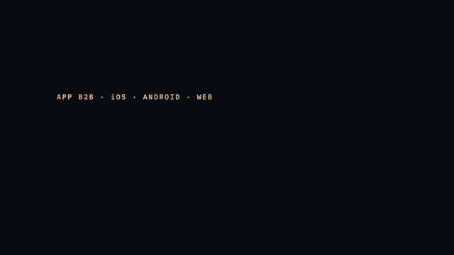
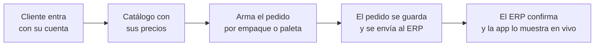
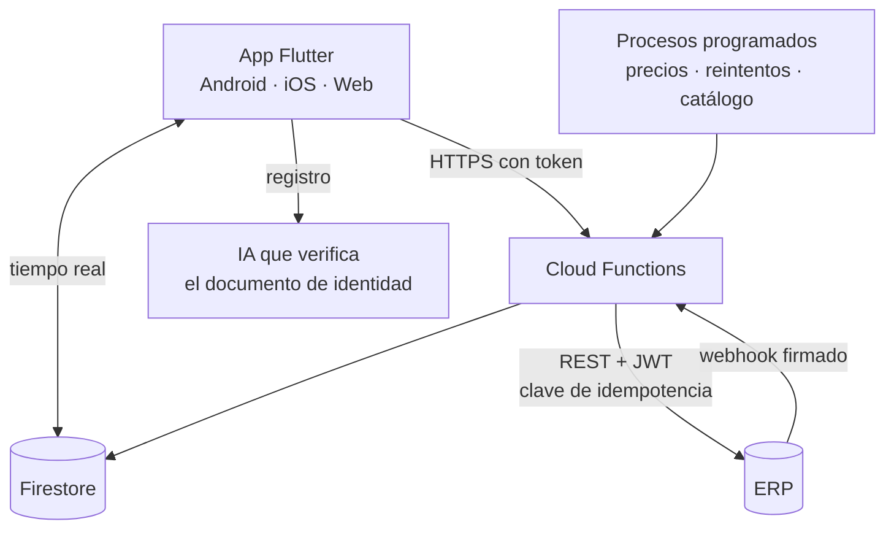
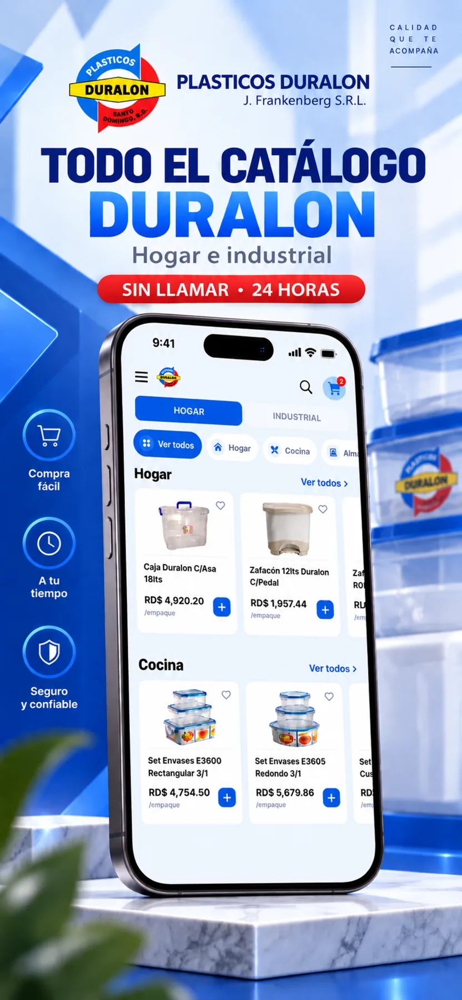
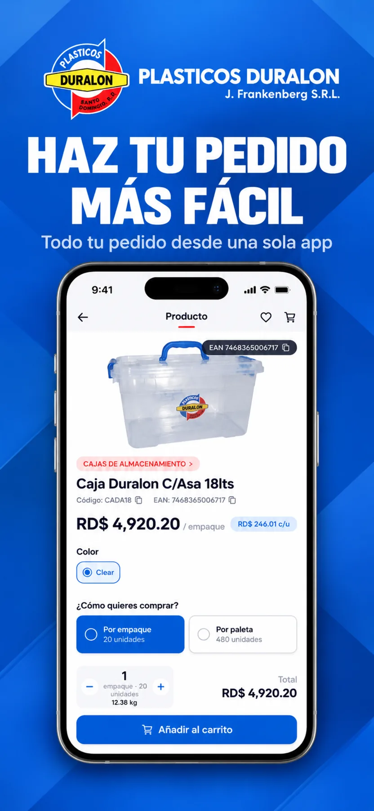
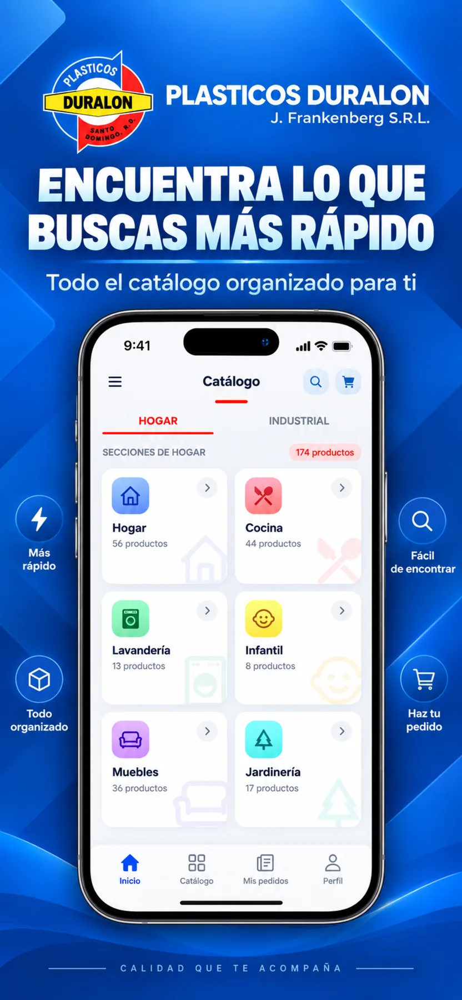

# App de pedidos B2B · Caso de estudio

> **Este repositorio es un caso de estudio, no contiene código.** El sistema es propiedad de la empresa donde está en producción y su código permanece privado. Aquí se muestra el problema, la solución, cómo funciona y los resultados.
>
> 🎬 Recorrido en video y más proyectos: **[portafolio de Yeison Rojas](https://ai-automation-portfolio-cyan.vercel.app)**
>
> 📱 Disponible en **[App Store](https://apps.apple.com/app/id6805665865)** y **[Google Play](https://play.google.com/store/apps/details?id=com.plasticosduralon.app)**

Canal B2B abierto 24/7 para un fabricante de plásticos: convierte los pedidos que llegaban por teléfono y WhatsApp en órdenes trazables que entran solas al ERP.

*Recorrido real de la app; los precios y los datos de clientes están ocultos.*

## El reto

Los clientes mayoristas pedían por llamada o WhatsApp. Sus precios vivían en el ERP, nadie veía las existencias al momento y el equipo de ventas tenía que volver a digitar cada pedido.

## La solución

- **Catálogo con el precio de cada cliente**, organizado por secciones, con búsqueda y compra por empaque o por paleta.
- **Pedido en minutos:** el cliente arma el carrito, descarga la cotización en PDF y confirma; la orden llega al ERP sin que nadie la digite.
- **Estado del pedido en vivo:** cuando el ERP cambia algo, la app lo muestra al instante.
- **Cuenta del cliente** con pedidos, cotizaciones, favoritos y direcciones, y entrada con Face ID o huella.
- **Tres plataformas** (Android, iOS y web) con el mismo código.

## Cómo funciona

## Resultados

| Indicador | Resultado |
|---|---|
| Pedidos procesados | **≈RD$120 M** (≈US$2 M) en 40 pedidos B2B y traslados internos |
| Pedidos atascados | **0**, con reintentos automáticos e idempotencia |
| Precios | sincronizados con el ERP **cada 30 minutos** |
| Costo de la nube | la carga de precios bajó de **287 a 48** corridas al día |
| Plataformas | **3**: Android, iOS y web, conectadas al mismo ERP |

## Arquitectura

## Decisiones técnicas

- **Ningún pedido se duplica.** El número que la app le da al pedido viaja al ERP como clave de idempotencia: si un envío se repite, el ERP actualiza el mismo pedido en lugar de crear otro.
- **Guardar primero, enviar después.** El pedido queda guardado antes de llamar al ERP. Si el ERP no responde, un proceso programado lo reintenta hasta 5 veces, en lotes de 25, y espera antes de reintentar un pedido que se cortó a medias para no enviarlo dos veces.
- **El precio lo decide el servidor.** El ERP calcula el precio con la lista de cada cliente y el backend ignora el precio que manda la app; también convierte los empaques a unidades.
- **Precios en un solo documento.** Cada 30 minutos un proceso reúne precios y existencias del ERP en un documento que la app lee de una sola vez; si está viejo, consulta el ERP por páginas.
- **Webhook firmado.** El ERP avisa cada cambio con una firma HMAC que se verifica en tiempo constante, y cada evento se procesa una sola vez.
- **Acceso seguro.** Claves guardadas con hash y salt, comparación en tiempo constante, bloqueo de 15 minutos tras 10 intentos fallidos y un token con el rol de cada cliente.
- **Verificación de identidad con IA** al registrarse: un modelo de IA revisa el documento de identidad que sube el cliente.

## Mi rol

Creador y arquitecto del sistema. Diseñé y desarrollé la app (Android, iOS y web), el backend en Cloud Functions y la integración con el ERP, y la publiqué en App Store y Google Play. También me encargo de su mantenimiento.

## Stack

Flutter (Android, iOS y web) · Node.js en Cloud Functions (HTTP, callable y programadas) · Firestore · Firebase Auth · Secret Manager · Firebase Hosting · Crashlytics · Integración con ERP por REST, JWT y webhooks HMAC · IA para verificar documentos · PDF

## Capturas

  
  
  

---

## English summary

**B2B Ordering App** is a 24/7 wholesale channel for a plastics manufacturer. It turns orders that used to arrive by phone and WhatsApp into traceable orders that reach the ERP automatically. Customers see their own prices, order by pack or pallet, download a PDF quote and follow each order live. It runs on Android, iOS and the web from one codebase.

**Results:** ≈US$2M (≈RD$120M) processed across 40 B2B orders and internal transfers, 0 stuck orders, prices synced with the ERP every 30 minutes, and the price job cut from 287 to 48 runs a day.

**Key engineering decisions:**
- End-to-end idempotency: the app's order number travels to the ERP as an idempotency key.
- Save first, send later, with scheduled retries (max 5, batches of 25) that avoid double-sending after a timeout.
- Server-side pricing from each customer's price list.
- All prices consolidated in one document, refreshed every 30 minutes.
- HMAC-signed ERP webhooks, verified in constant time and deduplicated by event.
- Salted password hashes, lockout after 10 failed attempts and role-based tokens.

**My role:** creator and architect of the system. I designed and built the mobile and web app, the Cloud Functions backend and the ERP integration, and shipped it to the App Store and Google Play.

**Stack:** Flutter, Node.js Cloud Functions, Firestore, Firebase Auth, Secret Manager, Hosting, ERP integration over REST/JWT and HMAC webhooks.

*This is a case study. The source code belongs to the company and stays private.*
